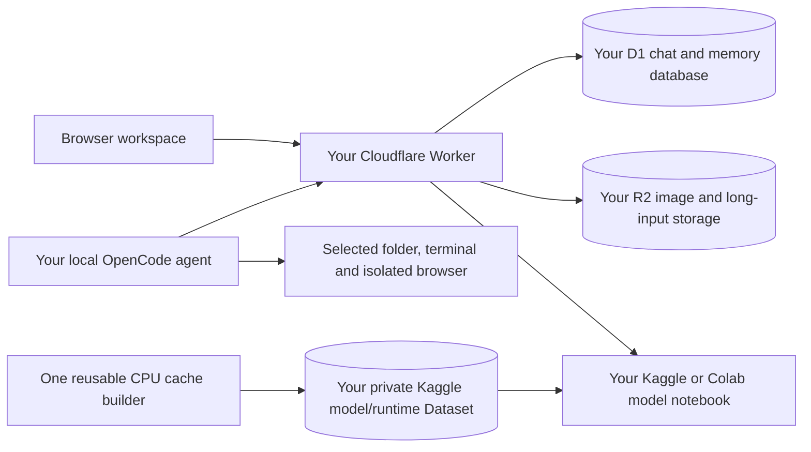

# Zero GPU with Local AI

A self-hosted Qwen workspace: browser chat, documents, pictures, working memory, and a local OpenCode coding agent. The model runs on Kaggle or Colab; your computer runs the interface and local tools.

**Deploy your own instance.** The source and downloadable template contain no maintainer service URL, Kaggle token, Cloudflare account identifier, chat history, or saved credentials.

[Download the source bundle](https://github.com/zamsonl/zero-gpu-with-local-ai/raw/main/DOWNLOAD%20ME.zip) · [Deployment guide](docs/SETUP.md) · [Architecture](docs/ARCHITECTURE.md) · [Privacy](docs/PRIVACY.md) · [Troubleshooting](docs/TROUBLESHOOTING.md)

## Included

- Current responsive browser interface, rounded neutral controls, adjustable chat width/text size/composer, independent chat drafts and scrollable streaming thinking.
- Streaming text and reasoning, per-chat thinking preferences, context estimates, manual/automatic compaction, saved working notes, Answer now and bounded continuation/recovery.
- Document attachments and opt-in processing of long text. Original material is retained; model attention remains finite.
- Image attachments and a separate Qwen-Image generation mode. Chat/image switching shares the notebook's GPU.
- Kaggle Qwen 27B Q5_K_P / 98,304 total context; Colab's smaller Qwen 9B Q6_K attempts 32K, 24K, 16K or 8K according to measured full-GPU fit. Available hardware is not guaranteed.
- Windows guided OpenCode setup with a modern folder picker, encrypted remembered token, install/reuse of reviewed local tools and isolated Playwright browser tools.
- Each local-agent user uses their own Kaggle account. First setup automatically creates an owned private model/runtime cache on CPU; later GPU sessions reuse its ready pinned Dataset.
- Optional local-agent models: **public Hugging Face GGUF only**, with pinned revision/checksum and actual tool/context/capability validation. No other model is silently substituted.

## Choose your path

| Goal | Start here |
| --- | --- |
| Deploy the complete browser workspace | [Cloudflare deployment](docs/SETUP.md) |
| Code in a local folder | Download the configured agent ZIP from **your deployed website**; open `Start Qwen OpenCode.cmd` |
| Run a notebook manually | [Kaggle](notebooks/kaggle.ipynb) or [Colab](notebooks/colab.ipynb); provide your own relay URL/key |
| Contribute or test without a GPU | [CONTRIBUTING.md](CONTRIBUTING.md) |

The complete app requires its Worker API; GitHub Pages alone cannot run that backend. The current interface source is `worker/public/`. The previous single-file/browser-only prototype has been replaced by this template; older source remains in Git history.

## What runs where

Local-agent history stays in the isolated OpenCode project/account directory on your computer. Website chats use the deployment's D1/R2 storage. The website is a workspace owned by its deployer; users sharing its workspace key share that website's cloud history. Local-agent sessions have separate account-scoped notebook controls and do not use the website owner's GPU as a fallback.

## Cache and long tasks

First local-agent setup downloads/verifies model/runtime files once in a private CPU notebook, uploads them, creates a private Dataset and waits for readiness before starting the GPU notebook. Each account/deployment reuses one CPU builder; immutable model/runtime versions have separate clearly named Datasets. Existing owned ready caches can be reused after reinstalls or a new relay database. Custom model cache hits retain checksum/import/tool/context checks. Model caches contain no conversations, tokens or project files.

Cache reuse saves compatible downloads. It does not remove notebook queueing or GPU memory loading. First use needs sufficient temporary disk and private Dataset storage. The cache is a **Dataset**, not a notebook output you should delete after every run.

Historical working notes stay model-visible across tool rounds, with native tool call IDs and actual results preserved. Notes are explicitly unverified; planning is not treated as execution. Automatic compaction uses the selected hosted model, and full original history remains saved. Summaries can lose detail; context and memory are not infinite. Recognized runner/tool-format failures receive one bounded recovery; failed tools, unknown streams, cancellation and memory failures are not replayed indiscriminately.

## Runtime and cost limits

Kaggle/Colab decide GPU access, queueing, quotas and session lifetimes. Closing or stopping a reply does not prove GPU allocation ended: confirm notebook shutdown. Colab's free managed runtimes restrict some web-service/UI uses; read its [official FAQ](https://research.google.com/colaboratory/faq.html) before using that backend.

Cloudflare services have plan limits and optional billable usage. Review [Workers limits](https://developers.cloudflare.com/workers/platform/limits/), [D1 pricing](https://developers.cloudflare.com/d1/platform/pricing/) and [R2 pricing](https://developers.cloudflare.com/r2/pricing/). This project does not promise unlimited or permanently free hosting. It uses no external AI provider for titles, compaction or browser planning.

Terminal tools run with your OS user's permissions; folder selection is not a shell sandbox. Review approvals and use a project with backups. The reviewed connector uses OpenCode **1.19.5 CLI**; the separate Desktop GUI is not configured by it.

## License

Project code is MIT; see [LICENSE](LICENSE). Model weights and bundled third-party components retain their upstream licenses. Weights are downloaded from upstream, not shipped in this repository or its ZIPs. See [THIRD_PARTY.md](THIRD_PARTY.md).
