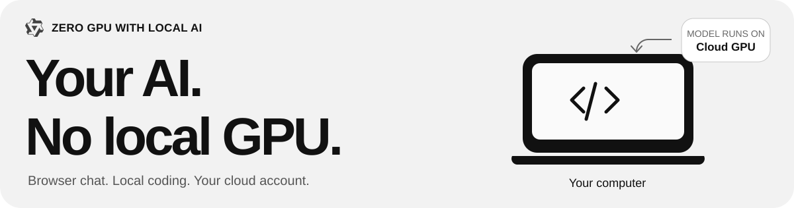
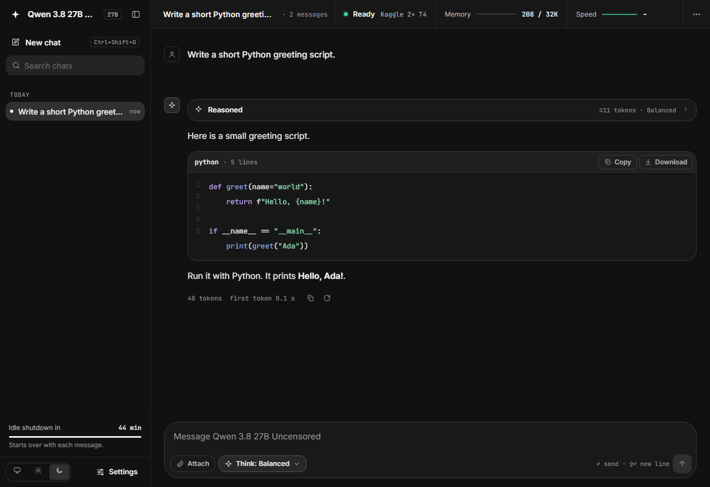
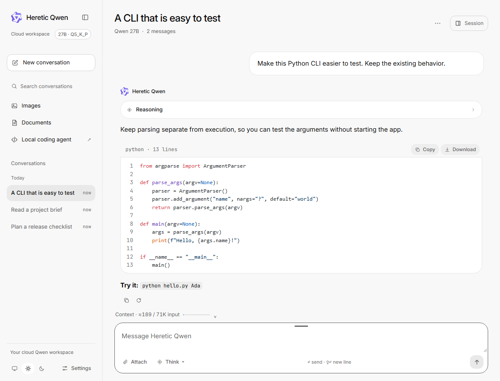
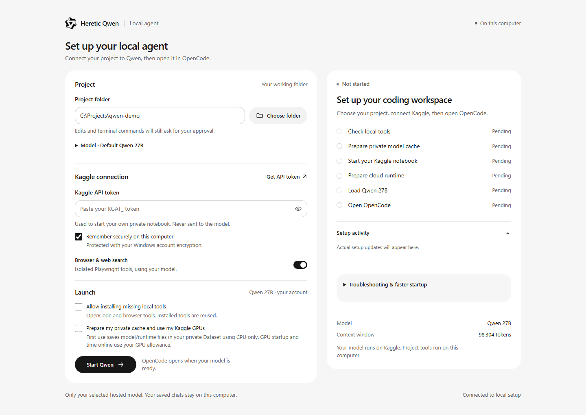
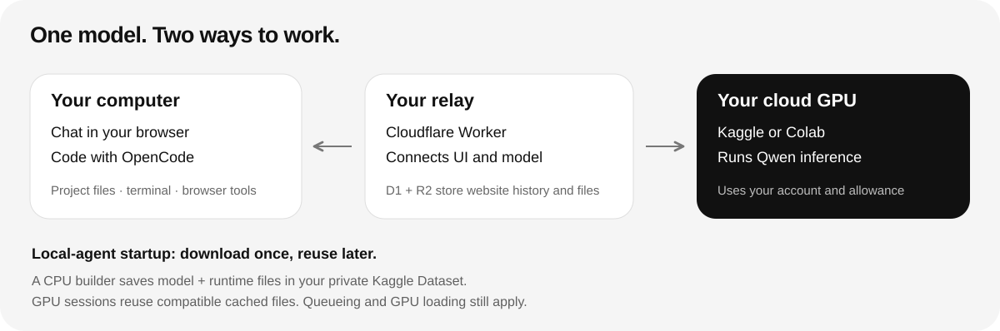

# Zero GPU with Local AI

Run Qwen on your Kaggle or Colab GPU and chat in your browser. **The chat app is already provided.** Start with the small Quick Start download; choose Advanced Setup when you need the full workspace and coding tools.

## Quick Start — recommended for beginners

**[Download Quick Start.zip](https://github.com/zamsonl/zero-gpu-with-local-ai/raw/main/Quick%20Start.zip)** · [Three-step guide](docs/QUICKSTART.md)

> **Caution:** Quick Start has **no compaction, no model/runtime caching, and no local coding agent**. For these features, use **[Advanced Setup](docs/SETUP.md)** and the **[DOWNLOAD ME.zip](https://github.com/zamsonl/zero-gpu-with-local-ai/raw/main/DOWNLOAD%20ME.zip)** download.

1. Extract the ZIP and double-click **START HERE.html**. Open its Kaggle notebook button.
2. In Kaggle, choose **GPU T4 x2**, turn **Internet on**, keep the notebook private, and select **Run All**.
3. Wait for **READY**, then click **Open the chat**. The supplied app connects automatically.

**No website to create. No Cloudflare account. No local model installation.** Quick Start uses your own cloud GPU account and allowance. You do not need a Kaggle API token; the notebook supplies a private connection key.

[Open the Kaggle notebook directly](https://www.kaggle.com/kernels/welcome?src=https://github.com/zamsonl/zero-gpu-with-local-ai/blob/main/notebooks/kaggle.ipynb) · [Colab notebook](https://colab.research.google.com/github/zamsonl/zero-gpu-with-local-ai/blob/main/notebooks/colab.ipynb) · [Open the supplied chat app](https://zamsonl.github.io/zero-gpu-with-local-ai/web/)

*Actual Quick Start interface with example data. If the supplied page cannot load, open the included `web/index.html` and paste the whole connection link from your notebook.*

Chat, stream thinking, attach documents and pictures when the model supports vision, and export/import chats. History stays in that browser. Quick Start leaves older messages out of the active prompt when needed; it does not summarize them. Fresh sessions download the runtime/model again.

## Advanced Setup — full workspace and local coding

**[Download Advanced Setup — DOWNLOAD ME.zip](https://github.com/zamsonl/zero-gpu-with-local-ai/raw/main/DOWNLOAD%20ME.zip)** · **[Follow the Advanced Setup guide](docs/SETUP.md)**

Use this optional path for compaction, private model/runtime caching, Qwen-Image generation, and the local OpenCode agent with project files, terminal commands and Playwright browser tools. It requires your own Cloudflare Worker/D1/R2 setup; follow the linked guide one section at a time.

| What you need | Quick Start.zip | DOWNLOAD ME.zip — Advanced |
| --- | --- | --- |
| Browser chat, streaming thinking, attachments | Yes | Yes |
| Where chats are saved | This browser | Your D1/R2 workspace; local coding history stays on your PC |
| Manual/automatic compaction | No | Yes, using your hosted model |
| Private model/runtime Dataset caching | No | Yes, in the local-agent setup |
| Local coding agent, terminal and browser tools | No | Yes, through OpenCode |
| Qwen-Image generation | No | Yes |
| Website deployment required | No | Yes; setup guide included |

<strong>Preview the advanced workspace and guided coding setup</strong>

<picture>
  <source media="(max-width: 600px)" srcset="docs/media/chat-mobile.png">
  <source media="(prefers-color-scheme: dark)" srcset="docs/media/chat-dark.png">
  
</picture>

These are actual advanced interfaces with example data. Each coding-agent user uses their own Kaggle account. First setup builds a private cache on CPU before starting the GPU. Later compatible sessions reuse it; queueing and model loading still apply.

Compaction retains useful working notes and full history, but summaries can lose details and model context remains finite. Recovery is bounded. The connector uses OpenCode 1.19.5 CLI; the separate Desktop GUI is not configured.

## Before you start

- Use an eligible GPU account and keep your notebook **private**. The connection link contains a session key: do not share it or publish notebook output.
- GPU availability, queues, quotas and session lifetimes depend on the provider. Free Colab managed runtimes restrict primarily interacting through a web UI; read its [official FAQ](https://research.google.com/colaboratory/faq.html). Kaggle is the recommended Quick Start path.
- When finished, choose **Shut the server down** in the chat, then confirm the notebook session stopped. Closing the chat tab alone does not prove GPU shutdown.
- Back up browser chats with **Settings → Your chats → Export all**. Browser data does not automatically follow you to another device.

## How it works

**Quick Start:** your browser connects directly to your notebook through its authenticated tunnel. The supplied chat page is static and does not use a maintainer model, private service or GPU account.

**Advanced Setup:** your interface and local coding agent connect through your own Cloudflare relay. D1/R2 store website history and files; the local-agent cache belongs to your Kaggle account.

[Quick Start guide](docs/QUICKSTART.md) · [Advanced Setup](docs/SETUP.md) · [Architecture](docs/ARCHITECTURE.md) · [Privacy](docs/PRIVACY.md) · [Troubleshooting](docs/TROUBLESHOOTING.md) · [Contributing](CONTRIBUTING.md)

Project code is [MIT](LICENSE). Model weights are downloaded upstream, not bundled in either ZIP; see [third-party notices](THIRD_PARTY.md). Provider limits and optional cloud charges still apply; unlimited or permanently free hosting is not guaranteed.
