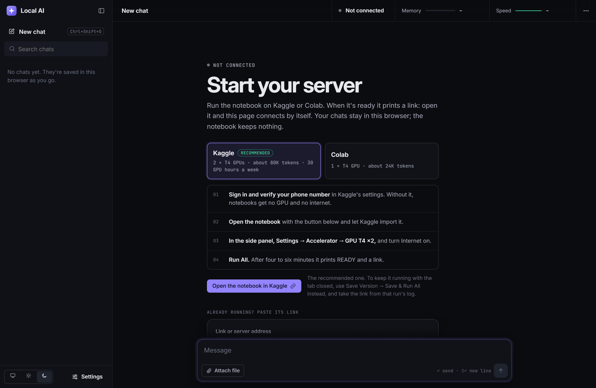

# Hardware limits for local AI? Fixed.

Run a 27B open model on free Kaggle or Colab GPUs, then chat from your browser or terminal. No GPU, no install, no bill.



Big open models need a big GPU. Kaggle and Colab lend you one for free, but only inside a notebook. This project turns that notebook into a private AI server: it installs [Ollama](https://ollama.com), loads the model, and gives you a link. Open the link and you are chatting with your own copy, from any device.

- **Default model:** an uncensored build of Qwen 3.8 27B. Swap in any model Ollama can run with one line.
- **On Kaggle's two free T4 GPUs** it holds about 80K tokens of conversation, entirely on the GPUs, at around 11 tokens a second.
- **Chats stay with you.** The web app keeps them in your browser. The notebook keeps nothing and forgets everything when its session ends.
- **Locked with a key.** Every request needs the key the notebook prints.
- **Two ways to chat:** a single-file web app, or a terminal client with no dependencies.

**[⬇ Download everything (DOWNLOAD ME.zip)](https://github.com/zamsonl/no-gpu-local-ai/raw/main/DOWNLOAD%20ME.zip)**: the Kaggle and Colab notebooks, the chat app and the terminal client, with a START HERE file. Then follow the steps below.

## How it works

```
 Kaggle / Colab notebook (free GPU)                                  your device
 ┌─────────────────────────────────────────────────────────┐
 │  Ollama + model  ◄──  gatekeeper (checks your key)  ◄───┼── Cloudflare tunnel ◄── web app or terminal
 └─────────────────────────────────────────────────────────┘
```

1. The notebook installs Ollama and `cloudflared` while it downloads the model (about two minutes for 21 GB on Kaggle).
2. It loads the model with the largest context that still fits entirely on the GPU, because spilling onto the CPU halves the speed.
3. A small gatekeeper sits in front of Ollama. It rejects any request without your key and only passes through chat-related calls, so nobody can pull, delete or swap models.
4. A free Cloudflare quick tunnel gives the gatekeeper a public `https://….trycloudflare.com` address.
5. The notebook prints a link to the chat app with the address and key after the `#`. Browsers never send the part after `#` to a web server, so the key stays out of every server log. The page's own code does read it, so if you'd rather not trust the hosted copy, use your own (see below).

Ready to chat about four to six minutes after you press Run, every session. Free notebooks start from a clean machine each time, so the model is downloaded again each time.

## Run it on Kaggle (recommended)

Kaggle gives every verified account 30 GPU hours a week on two T4s (30 GB of GPU memory between them), and sessions of up to 12 hours.

1. Sign in to [Kaggle](https://www.kaggle.com) and verify your phone number (**Settings → Phone verification**). Without it you get no GPU and no internet in notebooks.
   Kaggle's phone verification often fails: the code never arrives, or it says "too many requests". Don't keep retrying. Submit a request on Kaggle's help form at [kaggle.com/contact](https://www.kaggle.com/contact) and ask them to verify your account.
2. Open the notebook: **[Open in Kaggle](https://www.kaggle.com/kernels/welcome?src=https://github.com/zamsonl/no-gpu-local-ai/blob/main/notebooks/kaggle.ipynb)** imports it for you. Or choose **Create → New Notebook**, then **File → Import Notebook**, and upload [notebooks/kaggle.ipynb](notebooks/kaggle.ipynb).
3. In the notebook's side panel (**Settings**), set **Accelerator** to **GPU T4 x2** and turn **Internet** on.
4. Optional: to keep the same key every session, add a secret under **Add-ons → Secrets** named `NO_GPU_KEY` with any long random value, and attach it to the notebook.
5. Press **Run All**. When the output says `READY` (four to six minutes), click **Open the chat**.

To keep it running with the tab closed, use **Save Version → Save & Run All (Commit)** instead. It runs in the background, and the link appears in that run's log.

When you are done, use **Shut the server down** in the chat's menu (top right), or let the idle timer stop it. Either way the GPU hours stop counting.

## Run it on Colab

Colab's free tier gives you one T4 (15 GB), so the notebook picks a smaller build of the same model with about 24K tokens of context.

1. Open **[notebooks/colab.ipynb](https://colab.research.google.com/github/zamsonl/no-gpu-local-ai/blob/main/notebooks/colab.ipynb)** in Colab.
2. **Runtime → Change runtime type → T4 GPU**.
3. Optional: add a secret named `NO_GPU_KEY` (the key icon on the left) and give the notebook access.
4. **Runtime → Run all**, keep the tab open, and click **Open the chat** when it says `READY`.

A note on Colab's rules: its FAQ lists using a web UI instead of the notebook, and offering web services, among the things the free tier does not allow. This setup does both, so on free Colab it is at your own risk and the session may be cut off. Kaggle is the recommended home.

## Chat

**In the browser.** The link the notebook prints opens the hosted copy of the app at [zamsonl.github.io/no-gpu-local-ai/web](https://zamsonl.github.io/no-gpu-local-ai/web/), already connected. Each new session prints a new link; open it and the app reconnects. Already have the app open? Paste the link into **⋯ → Connect to a server**. Not running anything yet? The app's start screen walks you through starting a server on Kaggle or Colab.

The app is one file, [web/index.html](web/index.html), with nothing to build. If you would rather not use the hosted copy:

- open the file straight from your disk, or
- fork this repo and turn on GitHub Pages, or
- drop the file on Cloudflare Pages, Netlify or any static host.

Then set `APP_URL` in the notebook to your copy, so the link opens it.

**In the terminal.** Needs Node 18 or newer, nothing else:

```bash
node cli/chat.mjs "https://zamsonl.github.io/no-gpu-local-ai/web/#server=...&key=..."
```

Paste the whole link the notebook printed. After the first time, `node cli/chat.mjs` reconnects to the last server. Type `/help` for commands (new chat, switch chats, think level, attach a file or picture, shut the server down).

## Your chats

Everything you send and every reply is saved automatically, in your own browser.

- **What's kept:** the whole conversation, with the model's reasoning and any pictures or files you attached. It's saved while the reply streams in, so reloading mid-answer loses nothing.
- **Where:** your browser's own storage (IndexedDB), on that device. Nothing is written into the `index.html` file, nothing goes to GitHub or to the author, and the notebook keeps nothing.
- **One history per browser:** another browser, another device or a private window starts empty, and the hosted copy and a local `index.html` each keep their own. A private window forgets everything when it closes, and clearing your browser's site data deletes your chats.
- **Backing up and moving:** **Settings → Your chats → Export all** saves a file. **Import** loads it in another browser, or in the terminal client.
- **Terminal client:** keeps its chats as files in `~/.no-gpu-local-ai/chats/`, in the same format.

## Choose a model

Everything is set in the notebook's first cell:

```python
CONFIG = {
    "MODEL": "auto",
    "LABEL": "",
    "CONTEXT": "auto",
    "IDLE_MINUTES": 45,
    "KEY": "",
    "APP_URL": "https://zamsonl.github.io/no-gpu-local-ai/web/",
}
```

| Setting | What it does |
| --- | --- |
| `MODEL` | `"auto"` is the uncensored Qwen 3.8 27B: the Q5_K_P build on Kaggle, IQ3_M on Colab. Or any [Ollama library](https://ollama.com/library) name such as `"qwen3:32b"` or `"gemma3:27b"`, or a GGUF on Hugging Face as `"hf.co/<user>/<repo>:<quant>"`. |
| `LABEL` | The name the chat app shows. Empty: worked out from `MODEL`. |
| `CONTEXT` | Tokens of conversation the model keeps in mind. `"auto"` tries sizes from large to small and keeps the largest that fits entirely on the GPU. |
| `IDLE_MINUTES` | Shut down after this long without a message, to save GPU hours. `0` runs until the session ends. |
| `KEY` | Leave empty to use the `NO_GPU_KEY` secret, or a fresh random key each session. |
| `APP_URL` | The chat app the ready link opens. |

Rough sizes that fit entirely on the GPU, with room for context:

| GPU | Fits |
| --- | --- |
| Colab, 1 × T4 (15 GB) | up to about 14B at Q4, or a 27B at around 3 bits |
| Kaggle, 2 × T4 (30 GB) | 27B to 32B at Q4 to Q5, with long context |

Pictures work when the model can see them: the app checks, and only then accepts them. Thinking levels show up when the model reasons before answering.

## Privacy and safety

- **Your key is the lock.** Anyone with the link can use your server until the session ends. Do not post the link. A notebook made public on Kaggle also makes its run logs public, and the logs contain the link, so keep the notebook private (the default).
- **The tunnel address is public but random.** Without the key it only answers with a short note on how to send one.
- **Chats live in your browser**, never on the notebook or anywhere else. See [Your chats](#your-chats).
- **The model is uncensored.** It will not refuse, so what it produces is on you. You can swap in a regular model with `MODEL`.
- **Free tiers have rules.** Use this for your own interactive use. Do not run it as a service for other people, and do not use several accounts to get around limits.

## Troubleshooting

| Problem | Fix |
| --- | --- |
| `No GPU found` | Kaggle: Settings → Accelerator → GPU T4 x2. Colab: Runtime → Change runtime type → T4 GPU. |
| Install or download fails | Kaggle: turn Internet on (needs a verified phone number). |
| Phone verification won't work | Common on Kaggle. Stop retrying and ask Kaggle to verify you through [kaggle.com/contact](https://www.kaggle.com/contact). |
| The app says **Offline** | The session ended or went idle. Run the notebook again and open the new link. |
| The app says **Wrong key** | You opened an old link. Use the newest one, or set the `NO_GPU_KEY` secret so the key stays the same. |
| Replies are slow | The model spilled onto the CPU. Set a smaller `CONTEXT`, or pick a smaller model or quant. |
| `Thinking` is missing | The model does not reason before answering. Nothing to fix. |

## Running the tests

No GPU needed. A fake Ollama stands in for the real one, with the real gatekeeper in front of it.

```bash
python -m unittest discover tests
```

```bash
node --test tests/cli.test.mjs
```

```bash
node tests/web_test.mjs
```

The Python tests need Python 3.10 or newer. The terminal client's tests need Node 18 or newer, and the web test needs Node 22 or newer plus Chrome or Edge (it drives the page in a real headless browser).

To try the web app against the fake server, run `python tests/dev_server.py` and open the link it prints.

## Credits

- [Ollama](https://github.com/ollama/ollama) runs the model. MIT licence.
- [cloudflared](https://github.com/cloudflare/cloudflared) makes the tunnel. Apache 2.0.
- The default model is [HauhauCS's uncensored Qwen 3.8 27B](https://huggingface.co/HauhauCS/Qwen3.8-27B-Uncensored-HauhauCS-Aggressive-MTP-GGUF), built on Qwen by Alibaba. See the model page for its licence.
- [Inter](https://rsms.me/inter/) and [JetBrains Mono](https://www.jetbrains.com/lp/mono/) fonts, both SIL Open Font License, loaded from Google Fonts.

Built by [Zamson Lim](https://github.com/zamsonl). MIT licence, see [LICENSE](LICENSE).
