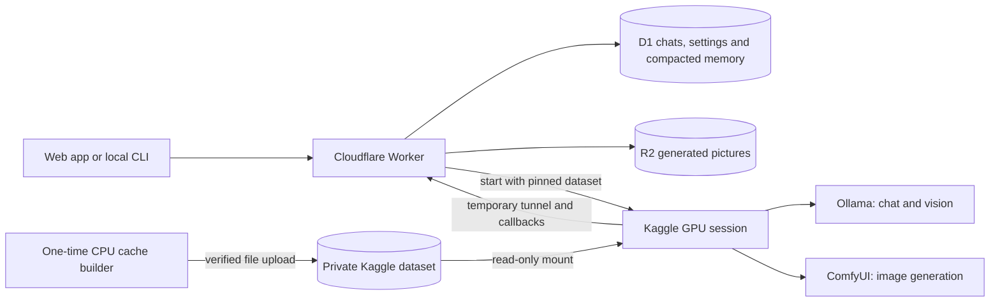

# Persistent Kaggle cache

Status: deployed and live verification complete on Worker
`0d36e0c5-f961-46c4-b6dc-20823f9e2079` and cached Kaggle notebook version 12.
The 98,304/batch-256 profile fits all 66 layers on GPU. Fresh chat, vision, the 87,211-token
input replay and manual near-full browser compaction passed. Only final operator-note copies
and the source diff check remain.

Pinned input: `exampleowner/heretic-qwen-cache/2`, private and READY, 18 files,
41,870,868,959 bytes. Serving notebook: `exampleowner/heretic-qwen-server`.
App: https://relay.example.invalid.

Version 12 hit the text, runtime and all four image caches without downloading those payloads.
Runtime startup took 26 seconds and server readiness took 331 seconds. All 66 layers loaded
on GPU at 98,304/batch 256; startup vision answered Red. Evidence:
`work/version12-startup-safe.json` and `work/profile-smoke-results.json`.

## Architecture

The dataset contains the chat GGUF, BF16 vision projector, four deployed image-model files,
the complete pinned Ollama Linux CPU/CUDA runtime, cloudflared, manifests and upstream notices.
Model and runtime payloads were SHA256-verified during the build.

Each serving session mounts the pinned dataset under `/kaggle/input`. Small configurations
are copied to writable storage, large immutable weights are linked into Ollama and ComfyUI
stores, and the runtime is extracted locally. Valid cache hits remove repeated external
downloads of those payloads.

Kaggle still allocates a fresh machine, mounts inputs and loads GPU memory. ComfyUI code and
small Python dependencies are installed during startup. Chat and image generation share the
GPUs by switching modes. The idle timeout and Kaggle session limits remain in effect.

The selected profile keeps the same 27B Q5_K_P model, BF16 projector and q8_0 KV precision,
with 98,304 total context and batch 256. D1 preserves original messages and compacted memory;
repeated compaction extends conversations with lossy summaries, not infinite model attention.
See [the context upgrade notes](CONTEXT_UPGRADE.md).

A local notebook job owns streamed inference independently of tunnel connections. The Worker
reads finite 15-second NDJSON legs until the first model record, then 90-second legs, resuming
the same authenticated job/cursor after a dropped leg. GET headers have a 30-second deadline.
Stop cancels the job; idle/runtime/output bounds also cover abandoned work.

Initial 90-second prefill legs failed in two controlled 87K tests at about 122.7/122.9 seconds.
A same-size 303,234-byte padded request with a 16-token prompt passed, excluding deterministic
upload size as the cause. The actual 87K replay passed after shortening silent prefill legs to
15 seconds. Buffering remains an inference, not a proven universal Cloudflare cutoff.

## Maintenance

`KAGGLE_CACHE_DATASET` selects an explicit `owner/slug/version`.
`KAGGLE_CACHE_ID` selects the expected model/runtime build. Attach only READY dataset versions.

To rebuild, update the builder's pinned sources and hashes, run private CPU builder
`exampleowner/heretic-qwen-cache-build`, save its uploaded files as a new dataset version,
verify the mount, then update both Worker variables. Cache failures log a clear message and
retain download fallback. A fallback/load exception clears the claimed learned profile;
the pinned text model never silently downgrades to a weaker quantization.

Startup safeguards allow a ten-minute Ollama load stall and retain bounded redacted HTTP-error
JSON. Future starts explicitly use `shift:false` for startup and vision to match website
inference and avoid the documented runner reload caused by differing shift options. Notebook
12 began on the prior startup script and was not restarted; current live app requests with
`shift:false` were verified.

Production staging uses Comfy-Org image models. The original local repository contains an
uncommitted alternative image-model selection; preserve it when syncing source. The temporary
transport diagnostic route is removed. Operator notes are synchronized.

## Validation

- Final frozen npm suite: 168 passed in 17 suites, zero failures/skips/cancellations,
  223,260 ms. Evidence: `work/context-project/jobs-final-prefill-test.log`.
- Startup runtime: eight passed, two Windows symlink checks skipped; Python compilation passed.
  Earlier Python jobs integration: 23 passed; base streaming proxy: 22 passed;
  Kaggle Linux filesystem: 17 passed.
- Offline real-cache CPU verification passed with Internet disabled in 13.54 seconds.
  Runtime extraction took 12.70 seconds; model inspection took 0.29 seconds. Ollama recognized
  the 27,320,697,856-parameter Q5_K_P model and projector. All four image files were linked;
  mounted inputs remained unchanged. All three runtime control-flow tests passed on Linux.
- Final live replay: 87,211 measured input tokens, 48 reply tokens, all three exact retrieval
  codes, full GPU, 98,304/batch 256, `truncate:false` and `shift:false`, with completion.
  Headers/first chunk: 16,649 ms; first model output: 322,593 ms; total: 331,356 ms;
  43 heartbeats and 711,099 response bytes. Fresh chat/vision also passed. The temporary
  chat was deleted and lock released without error. Evidence: `work/expanded-context-smoke-results.json`.
- Manual browser compaction passed: UI input estimate 70,399 to 23,829; API estimate 70,468
  to 23,898. Eight older messages were summarized and four recent messages retained in full.
  All 12 original messages remained SHA256-identical; ORBIT_913 recall passed. The fixture
  was deleted after its recall turn (14 messages). Evidence: `work/manual-compact-ui-results.json`
  and the two `outputs/manual-compaction*.png` screenshots.
- Transport isolation: same-size padded tiny-prompt request passed in 15.6 seconds with
  UPLOAD_OK and cleanup; Worker-only four-minute stream also passed. Failure/isolation
  evidence is preserved in `work/jobs-prefill-header-failure.json`,
  `work/job-upload-probe-worker-results.json` and `work/worker-transport-check-results.json`.

The one-time CPU build/upload took about 14 minutes and used no GPU. All nine large payload
filenames and sizes were checked after ingestion. No permanent Kaggle credential is embedded
in the builder or dataset. Seven exact temporary credential/upload/notebook-metadata artifacts
were deleted, and the upload probe was archived. The private D1 backup is preserved. Code sync
reported zero pending updates with the local image selection intact. Operator notes are
synchronized and final source checks passed.
